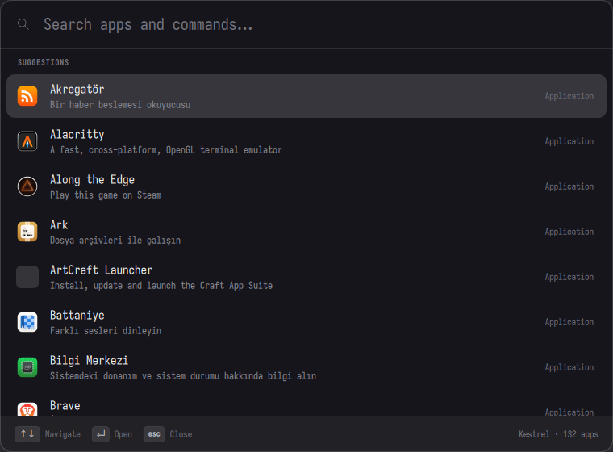

# Kestrel

A keyboard-first command palette for KDE Plasma — a Raycast counterpart for the Linux desktop.

Press a shortcut, type, hit Enter: the thing you meant opens. Kestrel is built around two numbers,
not around features — how fast the palette appears (**≤ 120 ms** from shortcut to first frame) and
how fast it answers a keystroke (**≤ 16 ms**, one frame). Everything else is negotiable.



- C++20 + Qt 6 (Quick/QML), no Electron, no WebEngine.
- 130+ applications indexed in the background at startup; typing never touches the disk.
- Ranking follows Raycast's model: fuzzy match class → score → frecency → collation.
- Frecency and learned search terms persist between launches.
- Single instance: a second launch toggles the running window instead of starting a new one.

Status: early. Applications launch, ranking and frecency work, KRunner bridging and the action panel
are not here yet — see [Roadmap](#roadmap).

## Requirements

| | |
|---|---|
| Qt | 6.6 or newer (`Core`, `Gui`, `Qml`, `Quick`, `QuickControls2`, `Concurrent`, `Test`) |
| CMake | 3.21 or newer |
| Build tool | Ninja (recommended) |
| Compiler | GCC 11+ or Clang 14+ (C++20) |

On Fedora: `sudo dnf install qt6-qtbase-devel qt6-qtdeclarative-devel cmake ninja-build gcc-c++`.
On Arch: `sudo pacman -S qt6-base qt6-declarative cmake ninja`.
On Debian/Ubuntu the packaged Qt is older than 6.6; use the AppImage below or a newer distribution.

## Build from source

```bash
git clone https://github.com/akamusti/kestrel.git
cd kestrel
cmake -S . -B build -G Ninja -DCMAKE_BUILD_TYPE=Release
cmake --build build
./build/kestrel
```

Run the tests with:

```bash
ctest --test-dir build --output-on-failure
```

If the window does not appear, check the QML side headlessly first — this catches QML errors without
a desktop session:

```bash
QT_QPA_PLATFORM=offscreen ./build/kestrel --quit-after-first-frame
```

## Installing

### 1. Run it from the build directory (simplest)

No installation is needed. Point your shortcut (below) at the absolute path of the binary, for
example `/home/you/kestrel/build/kestrel --toggle`.

### 2. Install into your home directory

```bash
cmake -S . -B build -G Ninja -DCMAKE_BUILD_TYPE=Release -DCMAKE_INSTALL_PREFIX="$HOME/.local"
cmake --build build
cmake --install build
```

This installs:

```
~/.local/bin/kestrel
~/.local/share/applications/dev.kestrel.Kestrel.desktop
~/.local/share/icons/hicolor/scalable/apps/dev.kestrel.Kestrel.svg
```

Make sure `~/.local/bin` is in your `PATH` (Plasma usually adds it). Kestrel then shows up in the
application menu, and the shortcut below can simply call `kestrel --toggle`.

To install system-wide, use `-DCMAKE_INSTALL_PREFIX=/usr` and `sudo cmake --install build`.

### 3. AppImage (built by GitHub Actions)

The repository ships a workflow (`.github/workflows/appimage.yml`) that builds a self-contained
AppImage on GitHub's runners, so you do not need Qt installed to run Kestrel:

1. Push a tag (`git tag v0.1.0 && git push origin v0.1.0`) or start the workflow manually from the
   **Actions** tab (**AppImage** → **Run workflow**).
2. When it finishes, open the run and download the **Kestrel-AppImage** artifact.
3. Unpack it, `chmod +x Kestrel-*.AppImage`, and run it:

```bash
./Kestrel-v0.1.0-x86_64.AppImage --toggle
```

The workflow has not been executed on a real runner yet — treat the first green run as the moment
it becomes supported.

### 4. Distribution packages

Not available yet. Packaging for Fedora/openSUSE/Arch follows once the feature set stabilises.

## Bind a global shortcut (KDE Plasma 6)

Kestrel has no in-app hotkey registration yet, so the shortcut is a normal KDE custom shortcut that
runs `kestrel --toggle`. That works even before the app is running: the first call starts it, and
every later call toggles the window of the already-running instance.

1. Install Kestrel somewhere in your `PATH` (see *Installing*), or note the absolute path of the
   binary.
2. Open **System Settings → Shortcuts**.
3. Click **Add New…** (bottom of the list) and choose **Command or Script…**.
4. In the dialog:
   - **Name**: `Kestrel`
   - **Command or script**: `kestrel --toggle` — or the absolute path, e.g.
     `/home/you/kestrel/build/kestrel --toggle`
   - **Shortcut**: click **Set Shortcut**, then press the combination you want.
5. Click **Apply**.

Good choices: `Meta+Space` (Super+Space) or `Meta+Return`. KRunner already owns `Alt+Space` by
default — either use a different combination or clear KRunner's shortcut in the same settings page
under **KRunner**.

Check that the command itself works before blaming the shortcut:

```bash
kestrel --toggle    # shows or hides the palette
```

Notes:

- The first call after login pays the cold start (indexing); keep the palette running and later
  toggles stay warm. Autostart entry is planned together with the D-Bus based single instance.
- The command runs as your user in your session; running it from another user or over SSH will not
  reach the running window.

## Keyboard shortcuts

| Key | Action |
|---|---|
| Type | Filter applications |
| `↑` `↓` | Move selection |
| `PageUp` `PageDown` | Jump a page |
| `Enter` | Launch the selected application |
| `Ctrl+1` … `Ctrl+9` | Launch the n-th result directly |
| `Ctrl+Shift+C` | Copy the selected name |
| `Esc` | Clear the query, or close when it is empty |
| `Shift+Esc` | Close and reset |
| `Ctrl+R` | Rescan the application index |

## How ranking works

Each application is scored four times — name, keywords, generic name, comment — using a dynamic
programming fuzzy matcher that rewards word starts and penalises gaps. A match must clear Raycast's
*medium* sensitivity threshold to be shown. Surviving results are sorted by match class first (exact
alias, exact learned term, exact title, prefix, overbounds), then score, then **frecency**: an
exponential score with a 10-day half-life, +100 points per launch. Queries that opened an item stay
associated with it for 17 days, so `ff` keeps meaning Firefox.

The observation notes behind these numbers, including the KRunner D-Bus contracts, live in
[`docs/re/raycast-findings.md`](docs/re/raycast-findings.md).

## Roadmap

1. [x] Skeleton: window, search, application list, Enter to launch
2. [ ] Global shortcut (`kglobalaccel` over D-Bus) + single-instance toggle
3. [x] Frecency + learned search terms (persisted, deferred flush)
4. [ ] KRunner bridge: query `org.kde.krunner1` runners over D-Bus (windows, calculator, units)
5. [ ] Action panel (`Ctrl+K`), filters (`Ctrl+P`), fallback web search
6. [ ] Calculator / unit / date inline results
7. [ ] File search (Baloo or an `fd` subprocess)
8. [ ] Clipboard history and snippets
9. [ ] Extension API (Raycast-shaped manifest, JSON-RPC process runtime)
10. [ ] Settings UI, Breeze palette, i18n

## Development

Read [`AGENTS.md`](AGENTS.md) before touching the code — it defines the layering, the performance
budget and the commit rules. Short version: business logic in C++, QML only binds and paints, no disk
I/O on the search path, and nothing is "done" until `ctest` is green.

Quick smoke test after a change:

```bash
cmake --build build && ctest --test-dir build --output-on-failure
./build/kestrel --grab /tmp/kestrel.png     # renders one frame to a PNG, then exits
```

## License

GPL-2.0-or-later — see [`LICENSE`](LICENSE).
